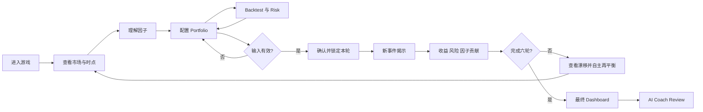

# Week 2 scope and UX foundation

版本：0.1 · 2026-09-18 · 可评审设计基线，真实用户验证待进行。

Week 2 收尾：用户已认可并冻结方向，稳定引用 `week2-ux-baseline`。本文件定义最终 MVP 的行为；现有静态线框是固定示例，缺少的输入/偏好/集中度/日志交互在 CP1 补齐，不能将设计要求当成现成功能。

## 问题、用户与价值

初学者常能复述因子名，却不能说明“为什么这样配置、事件之后为何亏损、风险指标如何改变下一次决策”。单独的行情面板无法验证这条理解链。

主要用户：参加课程、懂百分比但没有编程或专业投资经验的大学生。次要用户：需要观察学习过程的教师/展示评审。首版不服务真实资金投资者或专业量化研究员。

价值主张：在约 10–15 分钟的六轮体验中，把因子信号、板块配置、回测与风险解释连接起来，保留每轮决策和结果；以能解释取舍作为成功，而非只奖励最高收益。

## 游戏概念

工作名：FactorLab — 产业配置实验室（可改名，不涉及品牌决定）。

- 开局：100,000 虚拟资金；未配置资金为 Cash；无账户、无充值。
- 投资对象：半导体、机器人与工业自动化、先进材料、清洁能源装备、AI 与数字基础设施，均为虚构主题篮子。它们不代表全部市场，也不天然互相低相关。
- 一局六个模拟月；固定场景版本保证相同配置可复现；玩家可回顾已完成轮次，但不能改写历史结算。
- 不设“击败市场才过关”。完成六轮并能解释一次收益/风险取舍即完成；收益、基准差、风险各自展示，不合成不透明总分。
- 每轮：阅读已知市场 → 查因子 → 自主配置 → 可查看事前历史回测 → 确认锁仓 → 新事件揭示 → 结算 → 复盘 → 玩家再平衡。
- Coach 不生成可执行订单，不替玩家设置权重，不能启动回合。解释面板里不出现“一键接受 AI 配置”。

## MVP 范围与验收

| ID | 必需功能 | 最小行为 | 完成证据 |
|---|---|---|---|
| R01 | 完整游戏 | 六轮、可继续与重开、锁仓后才能结算 | 端到端录像与回合日志 |
| R02 | 多因子模型 | 4 因子、方向统一评分、默认等权合成；玩家可调整因子偏好 | 手算 fixture、评分屏 |
| R03 | 板块配置 | 5 + Cash，非负、总计 100%，显示风险与权重漂移 | 配置/再平衡屏与边界检查 |
| R04 | Backtesting | 在游戏前冻结历史上重放候选权重，与同口径基准比较 | 独立手算与回测屏 |
| R05 | 因子有效性 | 单期 Rank IC 与历史均值、样本数、Top–Bottom spread | 历史评价表，N/A 分支 |
| R06 | 收益/风险 | Return、Sharpe、Volatility、Maximum Drawdown | 定义、独立已知答案用例 |
| R07 | Benchmark | 每轮恢复五板块各 20%，Cash 0%，同一行情与日期 | 两条净值线与差值 |
| R08 | Diversification | 有效板块数、最大风险板块权重、Cash；不称为风险保证 | 集中与全现金示例 |
| R09 | Factor Contribution | 四因子 + 市场 + 事件 + 残差 + Cash，与总收益对账 | 单轮与跨轮贡献验算 |
| R10 | AI Investment Coach | 解释事实、风险与概念；在线 LLM 与断网规则 fallback 区分 | 固定评测集与失败路径录像 |
| R11 | Demo safety | 本地场景、离线主流程、进度恢复、重启可用 | 断网、刷新、重复点击测试 |

本轮只定义以上功能及线框；没有声称它们已经实现。不得把 R02/R04/R05/R06/R07/R09/R10 悄悄移出最终 MVP。

## 明确排除

真实交易与券商连接、真实行情在线依赖、外部实时新闻、期权/杠杆/卖空、个股订单簿、撮合与税务、预测 ML、策略自动寻优、RAG/向量数据库、多 Agent 协作平台、多人对战/排行榜、登录/支付/云同步、完整移动端、复杂成就系统、生产级交易风控。

交易成本暂设 0 并在界面披露；MVP 教学模型不模拟冲击成本、滑点或税。真实历史数据、多场景随机模式、更复杂成本为 backlog，不能挤占六轮闭环或核心量化指标。

## 信息架构

```text
开始
 ├─ 规则、虚拟资金与数据说明
 └─ 继续已保存进度（实际应用阶段）
游戏工作区：轮数 / 资产 / 本轮阶段
 ├─ 市场：五板块、已知事件、信号截止时点
 │   └─ 因子说明：含义、信号、局限、历史有效性
 ├─ 配置：权重、Cash、集中度、因子暴露
 │   └─ 事前回测：候选组合 vs 基准、风险、样本数
 ├─ 确认：本轮冻结配置与理由
 └─ 结算：事件、收益与风险、贡献 → 再平衡
结局
 ├─ Dashboard：七项必需指标、六轮决策记录
 └─ Coach Review：事实 / 解释 / 概念 / 玩家反思
```

## 用户流与状态规则



计划状态：INTRO → PLAN(r) → CONFIRM(r) → REVEAL(r) → RESULT(r) → PLAN(r+1) / FINAL → REVIEW。

- factor/backtest 是 PLAN 的子视图，返回时保留草稿；不改变回合号。
- 仅 CONFIRM 的一次有效提交冻结该轮配置。重复点击以 roundId 去重。
- REVEAL 前不显示该轮事件/收益；Coach 也不能收到未揭示数据。
- RESULT 可回看不能重算；必须显式进入下一轮。第六轮没有第七轮按钮。
- 未再平衡时沿用**结算后漂移权重**，不是自动回到上轮目标权重。
- 返回浏览器历史、刷新和 Coach 失败均不重复结算。
- 重开是明确动作；存在进度时先提示会结束本局。线框重开只是导航演示。

## 核心屏幕规格

桌面基准 frame 1440 × 900；主内容宽 1328；以表格、权重条和逐步解释为主，避免堆叠无上下文图表。红绿之外附正负号和文字；控件键盘可达；正式版最小正文 16 px。

| 屏幕 | 玩家问题 | 内容优先级 | 主动作 |
|---|---|---|---|
| Welcome | 我要做什么？ | 六轮任务、虚拟资金、非真实行情、耗时 | 进入实验 |
| Market | 现在知道什么？ | 时间截止、板块、四因子分数、已有事件 | 查看因子 / 配置 |
| Factors | 这个分数有什么用？ | 四定义、局限、有效性方法、样本量 | 返回市场 |
| Allocation | 我愿意承担什么风险？ | 六权重、合计、Cash、集中度、配置理由 | 查看事前回测 / 确认 |
| Backtest | 过去同样配置经历了什么？ | 固定历史范围、净值、风险、基准、偏差提示 | 返回修改配置 |
| Confirmation | 是否按此配置进入下一月？ | 权重快照、合计、成本假设、信息边界 | 锁定并开始 |
| Event | 刚发生了什么？ | 一个事件、可能传导渠道、已锁权重 | 查看结算 |
| Result | 为什么赚/亏了？ | 本轮及累计回报、基准、贡献、风险、漂移 | 自主再平衡 / 最终结果 |
| Final | 六轮学到了什么？ | 七项 Dashboard、逐轮记录、有效性观察 | Coach Review |
| Coach | 怎样解释我的决策？ | 事实证据、机制解释、局限、反思问题 | 查看指标来源 / 再玩一局 |

## 错误、空态与降级

| 条件 | 用户看到什么 | 恢复动作 |
|---|---|---|
| 权重总计 >100%、负值或非数字 | 就地错误与差额；确认不可用 | 修正权重，保留其他输入 |
| 合计 <100% | Cash = 剩余权重，明确显示；不悄悄归一化风险资产 | 查看 Cash 后确认 |
| 单一板块 100% | 集中风险提示；允许自主决定 | 修改或继续 |
| 全 Cash | 风险板块有效数 N/A，Sharpe N/A；可正常完成 | 保留现金或重新配置 |
| n<2 或波动为 0 | N/A + 原因，绝不显示 Infinity/NaN | 继续积累轮次 |
| 全部因子信号相同/缺失 | IC N/A，标注有效样本数；关键数据缺失禁止启动该场景 | 返回默认完整场景 |
| Coach 超时/断网 | “规则解释模式，非实时 AI 回复” | 继续游戏，可稍后重试 |
| 存档格式不兼容 | 明确说明旧进度不可载入，不覆盖原始记录 | 用户确认后新局 |

## 六类事件（剧本，不是现实预测）

1. 需求扩张：用于讲解景气、动量与行业差异。
2. 利率上行：用于讲解估值敏感性与负收益；不是固定因果定律。
3. 供应链瓶颈：解释板块之间相同与不同的冲击。
4. 技术突破：解释主题机会与集中风险。
5. 产业政策调整：解释规则变化和风险暴露。
6. 风险偏好骤降：展示相关性可能上升，分散不保证不亏。

每个事件固定 eventId、叙述、revealedAt、各板块冲击与解释；正负方向由审查过的教学剧本决定，不在演示时由 LLM 编造。

## Week 2 结束条件

问题/用户/价值、完整流程、MVP/排除项、IA、屏幕与错误态、财务口径、Figma frame/hotspot 清单均可评审；六轮线框可以逐步点击。此后需要真实参与者验证理解与导航，才能称为“validated”。
